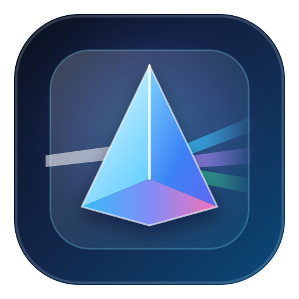

<p align="center">
  
</p>

<h1 align="center">PrismVault · 棱镜匣</h1>

<p align="center">
  跨盘符、零复制、全媒体本地索引资源管理桌面工具（WinUI 3 现代风格 · Electron + React + TypeScript + SQLite）
</p>

---

## 核心特性

- **跨盘符零复制索引**：可同时挂载 `D:\`、`E:\`、`F:\` 等任意盘符/目录，原文件原地不动，仅保存 SQLite 索引与轻量 WebP 缩略图缓存（支持自定义缓存路径并自动迁移）。
- **全媒体流 & 设计稿兼容**：
  - **图片**：JPG / PNG / WebP / GIF / SVG / AVIF / BMP / ICO / **TIFF**，以及 **Photoshop PSD / PSB**（自动生成缩略图、提取分辨率/色彩模式/位深度与图层结构、支持高清内嵌预览）。
  - **视频**：MP4 / WebM / MOV / MKV / AVI / FLV 等（基于本机 `FFmpeg` 自动抽帧与流信息提取，自定义零拷贝 HTTP Range 流式播放）。
  - **音频**：MP3 / WAV / FLAC / OGG / AAC / M4A / OPUS 等（内嵌封面提取与快捷试听）。
  - **文本与文档**：Markdown / TXT / JSON / YAML / CSV / 代码文件与 PDF 内置阅读。
- **剪贴板多文件 & 窗口全局拖放导入**：窗口聚焦时 `Ctrl + V` 支持剪贴板位图及资源管理器复制的多个文件/文件夹，也支持直接从系统拖放文件至软件窗口；自动归入当前选中分组（或未分类），提供数量/体积阈值提醒与同名文件并排缩略图对比弹窗（替换 / 跳过 / 都保留）。
- **Eagle 资源库无损迁移**：一键导入 `.library` 资源库，自动排除 Eagle 缩略图与回收站项目，完整还原多级子目录分组结构、注释、标签与来源链接，并可选是否保留原文件。
- **GitHub Releases 云更新**：支持启动静默检查新版本、Markdown 更新日志渲染、内置流式下载（支持进度/取消与可选下载加速镜像前缀），下载完成后可一键拉起新版安装向导（安装版）或定位压缩包目录（便携版）。
- **WinUI 3 一体化三栏工作台**：
  - 无边框一体化窗口标题栏，支持深/浅色主题与 4K 高分屏全局字体/字号自定义。
  - 左侧导航栏（快捷视图、素材类型多选、多对多层级自定义分组树与拖拽归组、索引源目录快筛）。
  - 中间主展示区（虚拟滚动 **瀑布流** + **等比网格** 双视图、卡片缩放、按名称/创建时间/修改时间/大小升降序排序，以及零卡顿一体化内嵌预览器）。
  - 右侧信息与备注栏（完整元信息 + **Markdown 自动保存备注**，纳入全局搜索；多选时自动切换批量操作面板）。
- **防断链保护**：通过内容指纹（文件大小 + 头尾 64KB SHA-1）自动重连外部移动/重命名的文件，无损保留备注与分组；外置盘拔出时标记为离线而不丢失备注。

## 开发与构建

```bash
# 安装依赖
pnpm install

# 开发模式启动桌面应用
pnpm run dev

# 类型检查
pnpm run typecheck

# 构建生产包
pnpm run build

# 预览生产构建
pnpm run preview

# 打包 Windows 可执行程序目录
pnpm run package
```

## 开源协议

本项目基于 [MIT License](./LICENSE) 开源，由 **熙云 (Xiyun)** 创建与维护。

- GitHub 仓库：[https://github.com/xiyunyun/PrismVault](https://github.com/xiyunyun/PrismVault)
