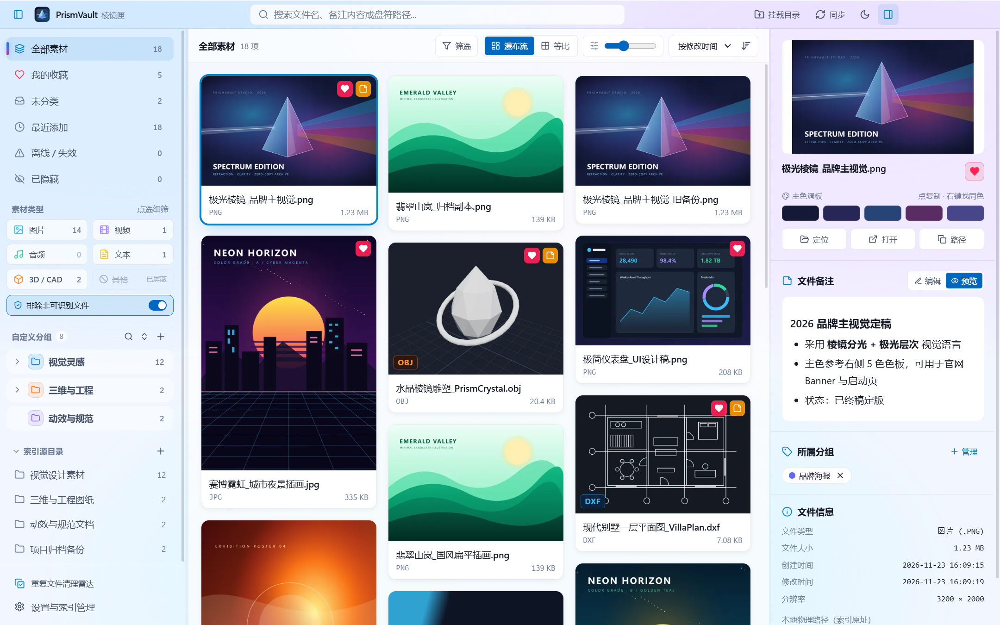
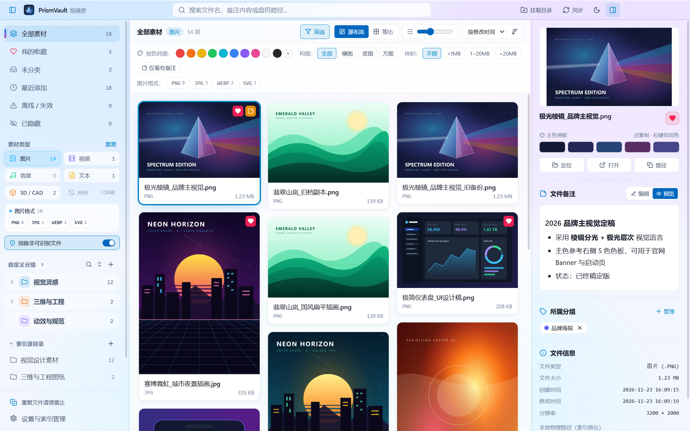
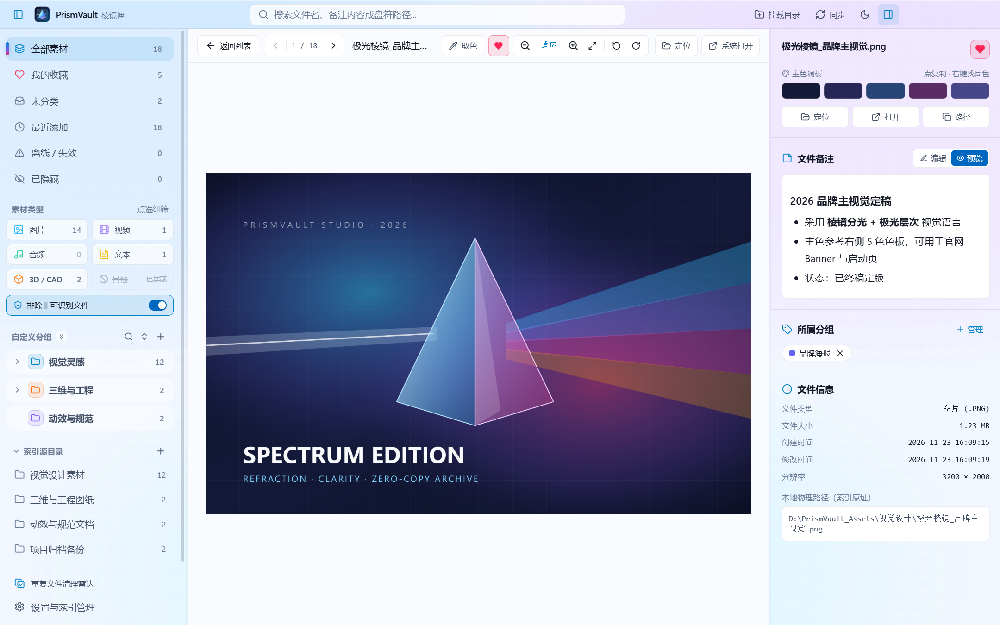
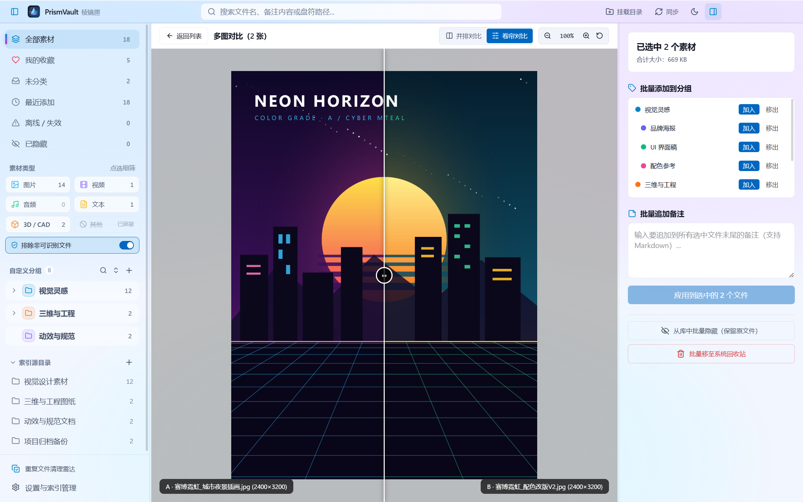
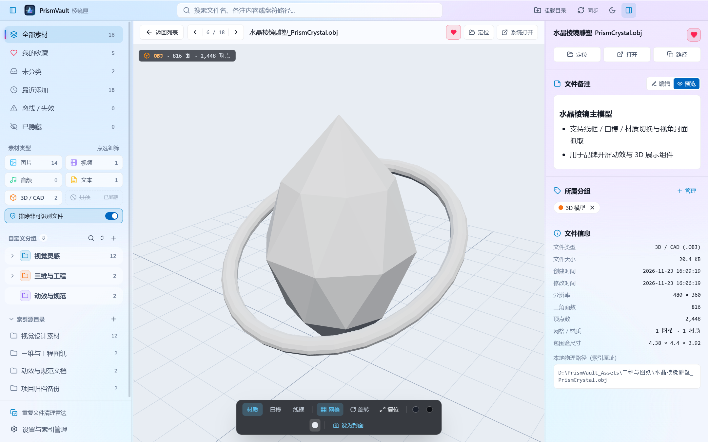
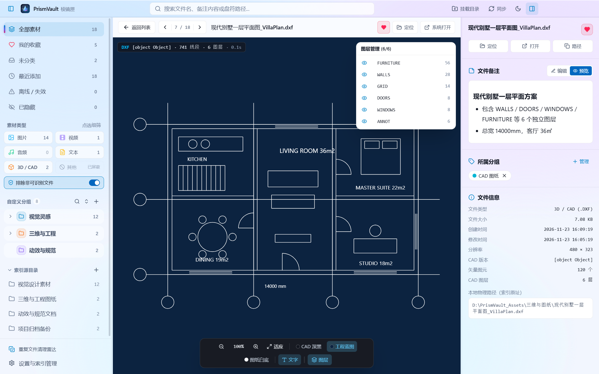
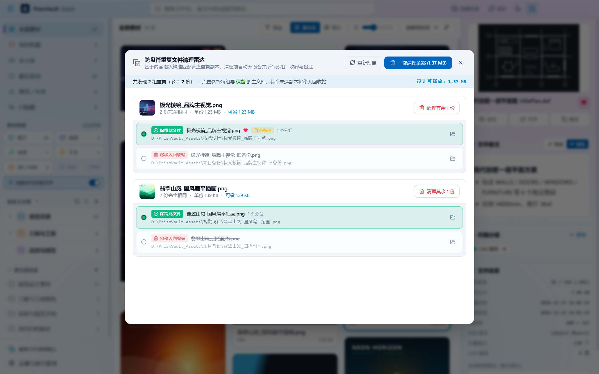
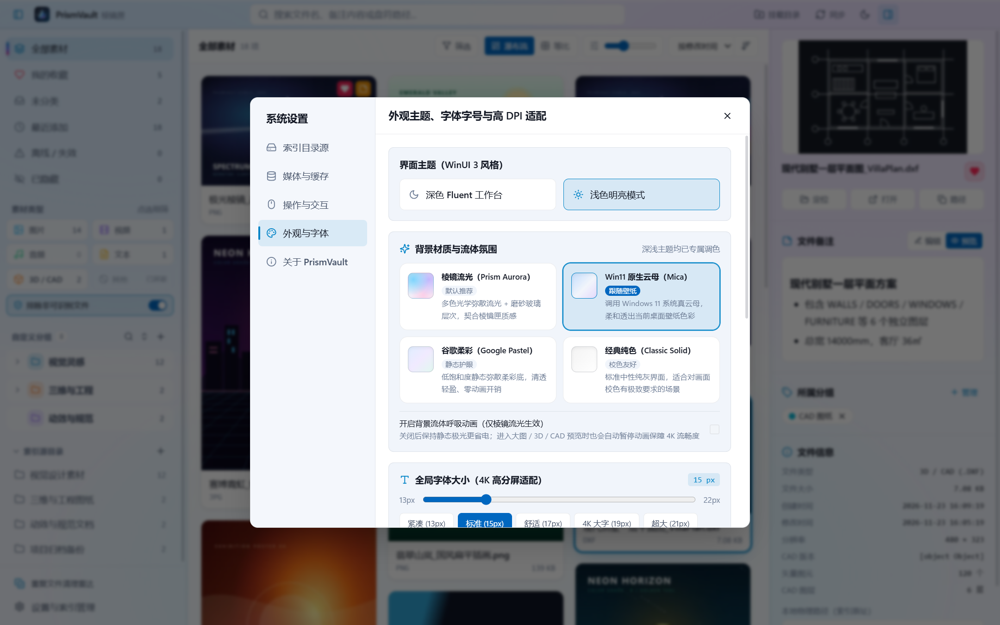

<p align="center">
  
</p>

<h1 align="center">PrismVault · 棱镜匣</h1>

<p align="center">
  <strong>跨盘符、零复制、全格式离线预览的本地视觉与设计素材管理工作台</strong>
</p>

<p align="center">
  <a href="https://github.com/xiyunyun/PrismVault/releases/latest">
    
  </a>
  
  
  
  <a href="./LICENSE">
    
  </a>
</p>

<p align="center">
  <a href="#-界面与功能展示">界面预览</a> ·
  <a href="#-核心功能一览">核心功能</a> ·
  <a href="#-支持的文件格式">支持格式</a> ·
  <a href="#-常用快捷键">快捷键</a> ·
  <a href="#-下载与安装">下载安装</a> ·
  <a href="#-本地开发与构建">开发构建</a>
</p>

<p align="center">
  
</p>

---

## 为什么选择 PrismVault？

素材散落在 D 盘、E 盘、移动硬盘里，传统素材管理工具动辄要求把几百 GB 原文件全部拷贝进专属库目录，既占双倍硬盘又打乱原有工程路径；遇到 PSD、3D 模型、CAD 图纸或视频，还得频繁打开重型专业软件才能确认内容。

**PrismVault（棱镜匣）** 为此而生：
- **原文件原地不动**：直接挂载任意盘符目录建立轻量索引，不搬运、不复制你的原文件；改名挪目录靠内容指纹防断链，移动硬盘拔出也不丢备注。
- **全格式离线直看**：图片、PSD/PSB、视频、音频、PDF/文档、3D 模型与 CAD 图纸全部在软件中间一体化流畅预览，无需来回切换软件。
- **随找随拖直接用**：按颜色、细分格式、构图、备注秒级定位素材，直接从软件里拖进 PS / Blender / CAD / 微信 / 桌面，彻底打通设计工作流。

---

## ✨ 界面与功能展示

### 1. Win11 原生云母工作台 · 多维筛选、按色找图与动态细分格式
左侧点选任意素材类型（如「图片」），下方会自动展开你库里**实际存在**的具体格式（如 `PNG`、`JPG`、`WEBP`、`SVG`）进行二次精筛；配合顶部可展开的多维筛选条，可自由组合**按色系/自定义色找图、横/竖/方构图、文件大小、仅看有备注**。左侧一键开启 **`排除非可识别文件`** 开关，即可直接屏蔽 `.dll`、`.exe` 等杂项文件，仓库只留有效素材。

<p align="center">
  
</p>

### 2. 中间一体化内嵌预览 · 吸管取色与 Markdown 备注
双击或按 `Space` 直接在中间窗口打开高清预览，左右侧栏保持常驻，可以边看图边记录或查阅 **Markdown 备注**、查看自动提取的 **5 色主色调板**（左键复制色号，右键直接按该颜色搜全库相似配色）。看图时支持滚轮缩放、双击放大/复原、左右 90° 旋转以及按 `I` 键开启**像素吸管取色**。

<p align="center">
  
</p>

### 3. 多图并排对比 & 双图卷帘滑块对比
选中 2～4 张图片按 `C` 键即可进入对比模式：支持多图并排同步缩放/拖拽找细节差异；选中 2 张图片时还可一键切换为**卷帘对比**，左右拖动中间滑块直观对比调色改版或前后效果图。

<p align="center">
  
</p>

### 4. 3D 模型 & CAD 图纸离线交互预览
无需启动 Blender 或 AutoCAD，直接在软件中流畅检视三维模型与工程图纸：
- **3D 预览**：支持 `.obj` / `.fbx` / `.glb` / `.gltf` / `.stl` / `.ply`，支持旋转缩放、材质/白模/线框切换、播放模型动画、一键将当前角度设为封面，并在后台自动生成 3D 缩略图。
- **CAD 预览**：独立工作线程解析 `.dwg` / `.dxf`，60 FPS 流畅缩放平移，支持 CAD 深黑 / 工程蓝图 / 图纸白底切换与**单图层独立开关**。

<p align="center">
  
</p>

<p align="center">
  
</p>

### 5. 跨盘符重复文件清理雷达
基于文件内容指纹，快速揪出分散在不同盘符、不同目录甚至改了文件名的完全相同副本。界面以**绿色「保留此文件」**与**红色删除线「将移入回收站」**清晰区分，清理前展示完整路径核对，并自动把所有副本的分组、收藏与备注**无损合并**到保留文件中，多余原文件安全移至 Windows 回收站（同时内置同物理文件保护，避免重叠目录误删）。

<p align="center">
  
</p>

### 6. WinUI 3 外观定制、四套背景材质与 4K 高分屏适配
内置深/浅两套主题与 **棱镜流光 / Win11 原生云母（Mica）/ 谷歌柔彩 / 经典纯色** 四种背景材质，支持 `13px–22px` 全局字号无级调节及自定义本机字体，在 2K / 4K 高分屏上同样清晰舒适。

<p align="center">
  
</p>

---

## 🧩 核心功能一览

### 一、跨盘管理与无损导入
- **跨盘符零复制挂载**：同时纳管多个盘符/目录，原文件原地不动，只建轻量 SQLite 索引与 WebP 缩略图缓存（缓存目录支持自定义并自动跨盘迁移）。
- **防断链与离线容错**：通过文件内容指纹自动重连移动或重命名后的文件；外接移动硬盘拔出后自动标为「离线/失效」，不丢失备注与分组，插回即可恢复。
- **实时文件夹监控**：可按目录单独开启监听，文件夹中新增或修改的素材自动同步入库。
- **剪贴板 & 拖放导入**：`Ctrl + V` 直接粘截图或复制好的多个文件/文件夹，或直接拖拽到窗口中入库；自动归入当前选中分组，提供数量/体积阈值提醒，同名冲突弹出左右缩略图对比弹窗（替换 / 跳过 / 都保留）。
- **Eagle 素材库一键无损迁移**：直接读取 `.library` 目录，自动过滤 Eagle 缩略图与回收站废件，完整还原多级嵌套分组、标签、备注、来源链接与原始时间戳。
- **一键排除非可识别文件**：左侧栏快捷开关一键屏蔽 `.dll`、`.exe` 等非素材杂项文件，仓库实时隐藏且扫描/拖放导入自动跳过。

### 二、全格式预览与设计辅助
- **图片与设计稿**：GPU 丝滑缩放拖拽、双 90° 旋转、透明图棋盘格底、边缘自动渐隐切图按钮；原生解析 **PSD / PSB** 图层信息与高清透明合成预览。
- **视频与音频**：视频卡片悬停 0.3s 静音循环预览、流畅拖拽进度条流式播放、支持「当前帧设为封面」；音频自动读取封面/歌手/专辑并支持卡片快捷试听。
- **文档、3D 与 CAD**：内置 PDF、Markdown、纯文本/代码/字幕阅读；3D 模型离线交互预览与自动封面；DWG/DXF 独立线程 60 FPS 矢量预览与图层控制。
- **对比与取色**：2～4 图并排对比 & 2 图卷帘对比（`C` 键）、图片像素吸管取色（`I` 键）、自动提取 5 色主色调板（点色块复制 / 右键按色找图）。

### 三、分类整理与精准检索
- **无限级自定义分组**：多级嵌套子分组、自定义颜色、自由拖拽排序与调整层级、分组内快速搜索、一键全展/全折；支持将物理文件夹树一键转为自定义分组。
- **多维与格式细筛**：6 大素材类型支持 `Ctrl` 多选 + 动态展开库内已有细分格式；顶部筛选条支持按色系/自定义颜色、构图比例、文件大小、仅看有备注组合检索。
- **快捷视图与 Markdown 笔记**：内置全部素材、我的收藏（`F` 键）、未分类、最近添加、离线/失效、已隐藏；每份素材支持 Markdown 备注与批量追加，顶部搜索框同时检索文件名、路径与备注。
- **重复文件清理雷达**：跨盘符内容指纹查重，无损合并分组/收藏/备注后安全移入回收站。

### 四、素材随取随用与日常常驻
- **原生向外拖拽 & 快捷复制**：直接从软件拖拽文件到 PS / Blender / CAD / 微信 / 桌面；`Ctrl + C` 复制文件，图片支持右键直接复制画面。
- **全局极速搜图浮窗**：类似 Spotlight 的悬浮搜索框（默认关闭，可在设置开启并自选快捷键），随时一键呼出，搜到直接拖出或复制。
- **双视图与大库流畅体验**：瀑布流 & 等比网格（4:3 / 1:1 / 16:9，填满/完整）自由切换，卡片大小滑块无级调节；SQLite 增量分页加载 + 后台缩略图与 3D 封面实时进度条。
- **托盘常驻与国内免代理云更新**：支持关闭退至系统托盘、开机静默自启、单实例防多开；内置多源 CDN 竞速测速、断点续传与 SHA-256 校验，软件内一键检测并升级。

---

## 📂 支持的文件格式

内置识别 **5 大有效素材类（共 94 种常见扩展名）**，其余未知扩展名归入「其他」并可一键屏蔽：

| 类别 | 已支持扩展名 | 特色能力 |
| :--- | :--- | :--- |
| **图片 & 设计稿** | `.jpg` `.jpeg` `.png` `.webp` `.gif` `.bmp` `.svg` `.avif` `.ico` `.tiff` `.tif` `.jfif` `.psd` `.psb` | 5 色主色调提取、吸管取色、多图/卷帘对比；PSD/PSB 解析图层与高清透明预览 |
| **视频** | `.mp4` `.webm` `.mov` `.mkv` `.avi` `.flv` `.wmv` `.m4v` `.ts` `.mts` `.m2ts` `.3gp` `.ogv` | 基于本机 FFmpeg 自动抽帧与流探测、卡片悬停静音预览、当前帧设封面 |
| **音频** | `.mp3` `.wav` `.flac` `.ogg` `.aac` `.m4a` `.opus` `.wma` `.aiff` `.aif` `.alac` | 读取内嵌专辑封面与标签、卡片一键快捷试听、内嵌播放 |
| **3D / CAD** | **3D**：`.obj` `.fbx` `.glb` `.gltf` `.stl` `.ply`<br>**CAD**：`.dwg` `.dxf` | Three.js 离线 3D 交互预览与自动封面；独立线程 60 FPS CAD 预览与图层开关 |
| **文档 / 代码 / 字幕** | `.pdf` `.md` `.markdown` `.txt` `.json` `.yaml` `.yml` `.xml` `.csv` `.tsv` `.log` `.ini` `.cfg` `.conf` `.env` `.toml` `.html` `.htm` `.css` `.scss` `.less` `.js` `.jsx` `.tsx` `.mjs` `.cjs` `.py` `.java` `.c` `.cpp` `.h` `.hpp` `.cs` `.go` `.rs` `.rb` `.php` `.sh` `.ps1` `.bat` `.sql` `.vue` `.svelte` `.srt` `.vtt` `.ass` `.lrc` | PDF 内置阅读；Markdown / 纯文本 / 代码 / 字幕内置阅读与摘要预览 |

---

## ⌨️ 常用快捷键

| 快捷键 | 功能说明 |
| :--- | :--- |
| `Space` / 双击卡片 | 打开 / 关闭中间一体化内嵌预览 |
| `F` | 收藏 / 取消收藏当前选中的素材 |
| `C` | 选中 2～4 张图片时，进入并排 / 卷帘对比模式 |
| `I` | 图片内嵌预览中，开启 / 关闭像素吸管取色 |
| `Ctrl + C` | 复制当前选中素材文件到系统剪贴板 |
| `Ctrl + V` | 将剪贴板截图或复制的多个文件/文件夹导入当前分组 |
| `Ctrl + A` / `Esc` | 全选当前列表 / 取消选择或退出预览与弹窗 |
| `Alt + Space`（可选） | 在设置中开启后，全局呼出「极速搜图浮窗」 |

---

## 📥 下载与安装

前往 [**GitHub Releases**](https://github.com/xiyunyun/PrismVault/releases/latest) 下载最新版本（Windows 10 / 11 x64）：

- **安装版（推荐）**：`PrismVault Setup x.x.x.exe`
  - 自定义安装目录，支持覆盖升级自动保留原有配置与数据库，支持开机静默自启与应用内一键拉起新版安装向导。
- **绿色便携版**：`PrismVault-x.x.x-win.zip`
  - 解压即用，无需安装。
- **视频预览提示**：若需视频自动生成缩略图与流信息提取，系统已安装 `FFmpeg` 会自动探测，也可在「设置 → 媒体与缓存」中手动指定 `ffmpeg.exe` 路径。

---

## 🛠️ 本地开发与构建

### 技术栈
- **桌面容器**：Electron 35 + electron-vite 3 + TypeScript
- **前端界面**：React 19 + Tailwind CSS v4 + Zustand + Lucide Icons
- **存储与索引**：Electron 内置 `node:sqlite`（零 C++ 原生编译，WAL + FTS5）+ Sharp + ag-psd + Three.js + LibreDWG WASM / dxf-parser + chokidar

### 运行命令（需 Node.js 22+ 与 pnpm）

```bash
# 安装依赖
pnpm install

# 开发模式启动桌面应用
pnpm run dev

# 双端 TypeScript 类型检查
pnpm run typecheck

# 构建生产包（out/）
pnpm run build

# 打包 Windows NSIS 安装版与便携版（dist/）
pnpm run package

# 扫描 dist/ 生成 latest.json 云更新清单（含体积与 SHA-256）
pnpm run release:manifest
```

---

## 📄 开源协议

本项目基于 [MIT License](./LICENSE) 开源，由 **熙云 (Xiyun)** 创建与维护。

- 项目主页：[https://github.com/xiyunyun/PrismVault](https://github.com/xiyunyun/PrismVault)
- 问题反馈：[GitHub Issues](https://github.com/xiyunyun/PrismVault/issues)
